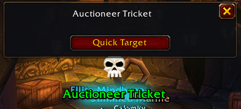
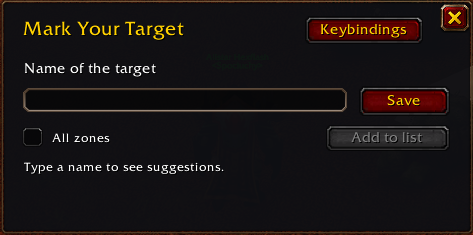
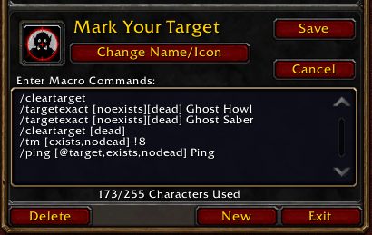

# Mark Your Target

A WoW: Forever add-on by **Goshdev** for when you keep changing the NPC name in the same targeting macro. Type `/myt`, pick a mob, and hit Save. You can keep the same macro on your action bar as you switch targets.

[CurseForge](https://www.curseforge.com/wow/addons/mark-your-target) · [GitHub release v1.4.0](https://github.com/grzelu1301/mark-your-target/releases/tag/v1.4.0) · [Project site](https://grzelu1301.github.io/mark-your-target/)

## Use it in game

1. Open the editor with `/myt` or click the crosshair on the minimap or in MinimapButtonButton.
2. Type an NPC name or choose a suggestion. For example, `Ghostm` finds **Ghostmaw** in Riverglades. Exact matches come first, followed by other matches from your zone, then the rest. **All zones** ranks results without the zone preference. Use **Show more** to browse past the first ten.
3. Press **Save** out of combat. The add-on creates or updates **Mark Your Target** with the Hunter’s Mark icon and selects it in WoW’s Macros window. Drag it onto an action bar to use it.

If you already know the name, type `/myt Ghostmaw` out of combat to save it directly in chat. Use `/macro` to find the macro after creating it this way.

The macro clears your old target, looks for the name you picked, clears a dead match, then tries to skull-mark and ping a living target using WoW’s macro commands.

## Quick Target

Type `/mytgt Ghostmaw` out of combat, then click **Quick Target**. You can assign a key in **Key Bindings → AddOns → Mark Your Target**. This uses no saved macro slot.

Use `/mytgt [@target]` to prepare your selected NPC or player, or `/myt [@target]` to update the saved macro. If pings are off, check **Enable Pings** in **Options → Ping System**.

## Install

Unzip the release into `World of Warcraft/_forever_/Interface/AddOns/` so that `MarkYourTarget/MarkYourTarget.toc` is directly inside `AddOns`. Restart WoW after installing or upgrading to v1.4.0 so the client picks up the new keybinding and icon files. The add-on targets **WoW: Forever 1.60.1**. MinimapButtonButton is optional.

## Screenshots

| Quick Target | Ping reminder | Minimap crosshair |
| --- | --- | --- |
|  |  |  |

| Pick an NPC | Save to WoW’s Macros window | Search across all zones |
| --- | --- | --- |
|  |  |  |

## NPC data

The add-on ships with 10,312 distinct English NPC names backed by Forever spawn records or player observations. 10,059 names have zone data. Coverage depends on the records available, and you can always enter a name manually. See the [data sources, verification, and rebuild steps](DATA-CREDITS.md).

The add-on code is licensed under [GPLv3](LICENSE.md).

Project icon adapted from [Crosshair by Delapouite](https://game-icons.net/1x1/delapouite/crosshair.html), licensed under [CC BY 3.0](https://creativecommons.org/licenses/by/3.0/). The artwork was recolored and exported as PNG.
