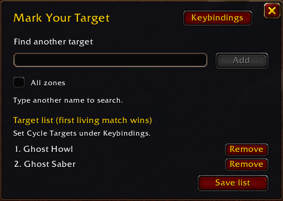
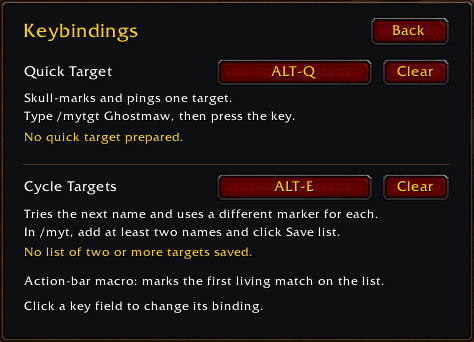
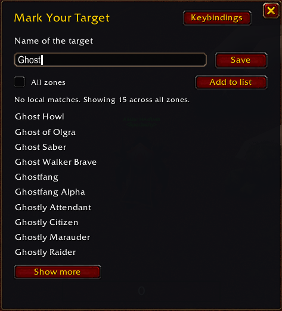
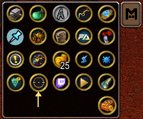
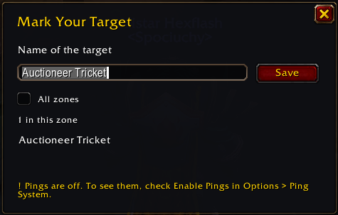

# Mark Your Target

A WoW: Forever add-on by **Goshdev** for finding named mobs, keeping a reusable targeting macro on your bar, and cycling through a saved list. Open `/myt` to save one name or build a list.

[CurseForge](https://www.curseforge.com/wow/addons/mark-your-target) · [GitHub releases](https://github.com/grzelu1301/mark-your-target/releases/latest) · [Wago](https://addons.wago.io/addons/mark-your-target) · [Project site](https://grzelu1301.github.io/mark-your-target/)

## Use it in game

1. Open the editor with `/myt` or click the crosshair on the minimap or in MinimapButtonButton.
2. Type an NPC name or choose a suggestion. For example, `Ghostm` finds **Ghostmaw** in Riverglades. Exact matches come first, followed by other matches from your zone, then the rest. **All zones** ranks results without the zone preference. Use **Show more** to browse past the first ten.
3. Press **Save** out of combat. The add-on creates or updates **Mark Your Target** with the Hunter’s Mark icon and selects it in WoW’s Macros window. Drag it onto an action bar to use it.

If you already know the name, type `/myt Ghostmaw` out of combat to save it directly in chat. Use `/macro` to find the macro after creating it this way.

The macro clears your old target, looks for the name you picked, clears a dead match, then tries to skull-mark and ping a living target using WoW’s macro commands.

## Target lists

Open `/myt`, type or select a name, and click **Add to list**. After the first entry, click a suggestion to add it directly, or type a name and click **Add**. Use **Remove** to revise the list. **Save list** updates the existing macro and opens WoW's Macros window. If the macro is already on your action bar, keep using that slot.

The saved macro tries exact names in list order, then skull-marks and pings the first living match in range. WoW limits the macro to 255 bytes, so the number of names that fit depends on their length.

For **Cycle Targets**, save a list of at least two names in `/myt`. Open **Keybindings** and click the field next to **Cycle Targets** to assign a key. The panel shows how many saved targets are available. Each press tries the next listed name, even if the previous name was out of range. Each entry has its own raid marker. Normal WoW targeting and marking permissions apply.

## Quick Target

Type `/mytgt Ghostmaw` out of combat, then press the **Quick Target** key or click the button. This is independent of anything saved through `/myt`. The **Keybindings** panel shows the prepared target. To assign a key, open **Keybindings** in `/myt` and click the field next to **Quick Target**. Both actions are also under **Options → Keybindings → Mark Your Target**. This uses no saved macro slot.

Use `/mytgt [@target]` to prepare your selected NPC or player, or `/myt [@target]` to update the saved macro. If pings are off, check **Enable Pings** in **Options → Ping System**.

## Install

Unzip the release into `World of Warcraft/_forever_/Interface/AddOns/` so that `MarkYourTarget/MarkYourTarget.toc` is directly inside `AddOns`. Restart WoW after installing or upgrading to v1.5.0 so the client picks up the new keybinding and icon files. The add-on targets **WoW: Forever 1.60.1**. MinimapButtonButton is optional.

## Screenshots

| Build a target list | Set shortcuts in the picker | Save to the Macros window |
| --- | --- | --- |
|  |  |  |

| Quick Target | Find a named mob | Minimap crosshair |
| --- | --- | --- |
|  |  |  |

| Open the picker | Ping reminder |
| --- | --- |
|  |  |

## NPC data

The add-on ships with 10,312 distinct English NPC names backed by Forever spawn records or player observations. 10,059 names have zone data. Coverage depends on the records available, and you can always enter a name manually. See the [data sources, verification, and rebuild steps](DATA-CREDITS.md).

The add-on code is licensed under [GPLv3](LICENSE.md).

Project icon adapted from [Crosshair by Delapouite](https://game-icons.net/1x1/delapouite/crosshair.html), licensed under [CC BY 3.0](https://creativecommons.org/licenses/by/3.0/). The artwork was recolored and exported as PNG.
